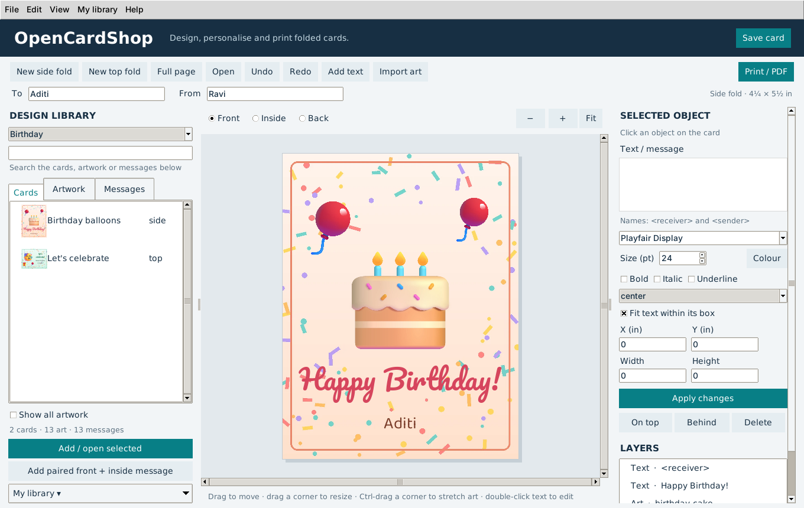
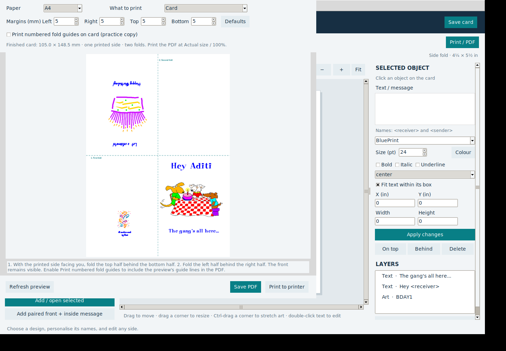

# OpenCardShop

A native, offline greeting-card editor for Linux and Windows. Choose a ready-made design or start a blank card, personalise the names, add your own pictures and messages, and print a quarter-fold card on one side of a single A4, Letter or Legal sheet.

OpenCardShop began as a reconstruction of the 1990s CardShop Plus editor and still opens CardShop Plus cards and CD content, but it does not need them: an open starter pack, the fonts installed on your computer, and your own reusable **My library** are enough to make cards. It needs no account and no internet connection while in use, and it does not run or include the original program.



## Install

### Windows 10 and 11 (64-bit)

Run `OpenCardShop-<version>-Setup.exe`. It installs for your user account only (no administrator rights) into `%LOCALAPPDATA%\Programs\OpenCardShop`, with its own Python, Tk and Pillow, and adds Start menu and desktop shortcuts and the `.occard` file type. The installer is not code-signed, so Windows SmartScreen may ask you to confirm it (**More info → Run anyway**). Remove it from **Settings → Apps**; your cards and My library are kept.

For command-line export, use `opencardshop-cli.cmd` in the installation folder.

### Debian, Ubuntu, Kubuntu, Mint

```bash
sudo apt install ./opencardshop_<version>_all.deb
opencardshop
```

The package works on Debian 12 or newer and Ubuntu 22.04 or newer. apt installs the dependencies (Python 3.10+, Tk, Pillow 9+, DejaVu and Liberation fonts). Remove it with `sudo apt remove opencardshop`; your cards and My library are kept.

### Any Linux, from source

Extract the source ZIP, install the dependencies once, then run `bash run.sh` in the `OpenCardShop` folder.

| Distribution | Dependency command |
| --- | --- |
| Ubuntu, Kubuntu, Mint, Debian | `sudo apt install python3 python3-tk python3-pil python3-pil.imagetk` |
| Fedora | `sudo dnf install python3 python3-tkinter python3-pillow python3-pillow-tk` |
| Arch Linux | `sudo pacman -S python tk python-pillow` |

Python 3.10 or newer, Tk 8.6 or newer, and Pillow 9 or newer are required. The editor runs in a desktop session through X11 or XWayland. For a distribution with an older Pillow, use a virtual environment:

```bash
python3 -m venv .venv
.venv/bin/python -m pip install -r requirements.txt
OPENCARDSHOP_PYTHON=.venv/bin/python bash run.sh
```

## What you can make cards with

- **The open starter pack** (`assets/starter/`, always included): 14 occasions (birthday, anniversary, wedding, new baby, congratulations, thank you, get well, Diwali, Holi, Eid, Christmas, New Year, any day, awards and certificates), 18 ready-made cards, 65 clipart pictures, 29 backgrounds, 149 newly written messages, and 7 display fonts. Everything in it may be shared and redistributed; see [NOTICE.md](NOTICE.md).
- **The fonts installed on your computer.** They appear in the font list after the starter and CardShop fonts. Saved cards embed the fonts they use, so they open the same way on another computer.
- **My library**, your own reusable collection (see below).
- **CardShop Plus content, if you own the CD** (optional). The CD (catalogued at <https://archive.org/details/cardshopplus>) adds 28 occasions, 231 designs, 616 pieces of clipart, 1,080 messages and 60 fonts. It is still under its original copyright, so it is not included. Choose the CD folder (the one containing `CARDSHOP.INI`) with **File → Open another asset folder…**; OpenCardShop remembers it. You can also extract it to `~/.local/share/opencardshop/cardshop` (Linux) or `%LOCALAPPDATA%\OpenCardShop\cardshop` (Windows), or, in a source checkout, to `assets/original/`:

  ```bash
  7z x CARDSHOP101.ISO -oassets/original      # 7z: sudo apt install p7zip-full
  python3 tools/rebuild_assets.py --inkscape  # optional artwork cache; Inkscape: sudo apt install inkscape
  ```

  Without the cache, artwork is drawn by the built-in renderer; one artwork with rotated text (ANY94) then uses its bitmap preview.
- **A private OpenCardShop asset pack** (`OpenCardShop-<version>-CardShopPlus-assets.zip`), unzipped over a source checkout. Keep it private.

## My library: your own pictures, messages and designs

Everything you add to My library is available in every card, and stays when you update or reinstall OpenCardShop. Use the **My library** menu or the **My library ▾** button under the design library:

- **Add pictures…** copies PNG, JPEG, WebP, GIF, BMP or WMF pictures into the library.
- **Add a message…** stores a front, inside and back message together; **Save selected text as a message** stores the text you selected on the card.
- **Save selected picture** keeps a picture from the current card.
- **Save this card as a design…** keeps the whole card as a reusable design, with a thumbnail.
- **Remove selected item…** deletes the selected picture, message or design from the library.
- **Export My library… / Import a library…** copy the whole library to or from a `.zip` file, for another computer, a shared kiosk, or a backup. Import adds to the existing library and skips duplicate messages.
- **Open My library folder** shows the folder. Pictures copied straight into its `art` folder also appear.

Choose **My library** in the occasion list to see and use your items.

| | Linux | Windows |
| --- | --- | --- |
| My library | `~/.local/share/opencardshop/my-library/` | `%LOCALAPPDATA%\OpenCardShop\my-library\` |
| Settings (CD folder) | `~/.config/opencardshop/settings.json` | `%APPDATA%\OpenCardShop\settings.json` |
| Caches and print files | `~/.cache/opencardshop/` | `%LOCALAPPDATA%\OpenCardShop\Cache\` |

Set `OPENCARDSHOP_HOME=/some/folder` to keep all three in one folder instead, for example on a USB stick. Set `OPENCARDSHOP_NO_SYSTEM_FONTS=1` to offer only the bundled fonts.

## Features

- Side folds, top folds and full-page designs; front, inside and back editing views.
- Name substitution with `<receiver>` and `<sender>`; editable text, font, size, colour, alignment, bold, italic and underline.
- Move and resize objects, select several objects, arrange layers, copy and paste between sides, undo and redo.
- Import PNG, JPEG, BMP, GIF, WebP and the supported placeable-WMF/CMF subset.
- Portable `.occard` files with the artwork and fonts embedded.
- One-sheet A4, Letter and Legal PDF export, current-view PNG export, and printing through CUPS on Linux or through your PDF viewer on Windows.
- Separate left/right/top/bottom margins, live numbered fold guides, and a marked printer/folding test with a 100 mm ruler.
- With the CardShop Plus CD: its 231 designs, 616 artwork entries (611 recovered vector sources, 3 bitmap previews, 2 marked unavailable), 1,080 messages and 60 font files.

Choose an occasion on the left and double-click a card. Enter **To** and **From**, select an object, change its properties, and press **Apply changes**. Use **Save card** for an editable `.occard` and **Print / PDF** for a folded print layout.

## Printing

**Print / PDF** offers two layouts, with a live preview:

- **One-sided, fold twice** (the original CardShop method): all four faces on one side of one sheet; the card is a quarter of the sheet. Print one-sided.
- **Two-sided, fold once**: back and front on side 1, the inside on side 2; the card is half the sheet (A5 from A4). Print two-sided with **flip on short edge**. Printers without duplex print side 1, then side 2 after you re-insert the sheet, and a two-sided test sheet shows how your printer aligns the sides.

**Save PDF** writes the pages at 300 dpi; **Print** sends it to a CUPS printer on Linux, or opens it in your PDF viewer on Windows (and on Linux without CUPS). Always print at **Actual size / 100%** with Fit to page turned off. The [user guide](docs/USER_GUIDE.md#printing-folded-cards) has the folding table and a test-sheet procedure.



## Command-line export

Export works without a display (installed packages: `opencardshop` on Linux, `opencardshop-cli.cmd` on Windows; from source: `python3 main.py`):

```bash
opencardshop /usr/share/opencardshop/assets/starter/cards/birthday-balloons.occard --export birthday.pdf --paper A4
opencardshop mycard.occard --layout half --export mycard-two-sided.pdf
opencardshop mycard.occard --export inside.png --side inside
opencardshop --test-page --fold side --paper A4 --export folding-test.pdf
opencardshop --test-page --fold top --paper Legal --margins 5 8 5 10 --export top-fold-test.pdf
opencardshop --assets /path/to/cd /path/to/cd/BDAY/BDAY1.CMK --export bday1.pdf
```

PDF export puts every card face on one printed side of one sheet. PNG export contains the chosen editing view; `--test-page` PNG export contains the whole marked sheet. A saved card's paper and margins are used unless overridden: `--margin 5` sets all four edges, `--margins LEFT RIGHT TOP BOTTOM` sets them separately. `opencardshop --help` lists every option.

## Documentation and validation

- [User guide](docs/USER_GUIDE.md): editing, My library, saving, folding and troubleshooting.
- [Reverse-engineering notes](docs/REVERSE_ENGINEERING.md): the SZDD, WMF and MFC/CMK layouts.
- [Validation report](docs/VALIDATION_REPORT.md): checks performed and the limits of recovery.
- [Original executable inspection](docs/EXECUTABLE_ANALYSIS.md) and [runtime comparison](docs/RUNTIME_COMPARISON.md).
- `examples/print-tests/`: ready-to-print practice PDFs and folding instructions.
- `assets/starter/ATTRIBUTION.md`: the source and licence of every starter-pack file.

## Development

```bash
python3 -m unittest tests.test_core tests.test_ne tests.test_printing tests.test_library -v
python3 -m unittest tests.test_gui -v   # needs a display, or: xvfb-run -a python3 -m unittest tests.test_gui
```

The tests keep their settings and My library in a temporary folder. Without CardShop Plus content, the tests that need it skip; the starter pack, My library, printing and no-library desktop tests still run.

Build the packages (no CardShop content is ever packaged):

```bash
bash packaging/build_deb.sh            # dist/opencardshop_<version>_all.deb; needs dpkg-deb, optional lintian
bash packaging/build_windows.sh        # dist/OpenCardShop-<version>-Setup.exe; needs nsis, curl, python3-pip, python3.12
```

The Windows build downloads Python and Tcl/Tk for Windows from conda-forge and Pillow's official Windows wheel from PyPI, assembles them like a python.org installation, checks every DLL dependency, and runs NSIS.

Rebuild the starter pack from its sources (needs `librsvg2-bin` and network access to GitHub):

```bash
python3 tools/build_starter_pack.py
```

With the CD present, rebuild the CardShop artwork cache with `python3 tools/rebuild_assets.py --inkscape`, or try the independent Python WMF renderer with `--output /tmp/cardshop-python-render`. That renderer handles the observed drawing subset but is not a complete Windows GDI implementation. `python3 tools/inspect_ne.py --report /tmp/cardshop-executable.json` reproduces the executable inventory.

## Versions

- **1.3.1** adds the two-sided, fold-once layout (half-size card) with duplex printing (flip on short edge), a side 1 then side 2 option for printers without duplex, a two-sided registration test sheet, and the `--layout half` command-line option. The chosen layout is saved in the card. All 68 automated checks pass on the same four Python/Pillow/Tk combinations.
- **1.3.0** works without the CD: an open starter pack, the fonts installed on the computer, and My library for reusable pictures, messages and designs with zip export and import. Adds a Debian package and a Windows installer, printing through the PDF viewer where CUPS is unavailable, and support for Pillow 9 (Debian 12, Ubuntu 22.04). All 64 automated checks pass on Python 3.10/Pillow 9.0, 3.11/Pillow 9.4, 3.12/Pillow 10.2 and 3.12/Pillow 13 with Tk 8.6 and 9; two optional PDF-inspection checks skip without PyMuPDF. The Windows installer was checked by inspection and dependency analysis but has not yet been run on Windows.
- **1.2.0** moved all CardShop Plus content into a separate private asset pack, let the editor start without it, centred each folded panel in its quarter of A4 and Legal sheets, and sharpened PDF images.
- **1.1.0** added Legal paper, four print margins, numbered fold guides, the folding/printer test sheet, remembered print settings and physical-fold orientation checks.

## Licence

New application code is MIT licensed (`LICENSE`). The starter pack uses the MIT and SIL Open Font licences listed in [NOTICE.md](NOTICE.md). CardShop Plus content keeps its original copyright and is never part of this repository or its packages.
